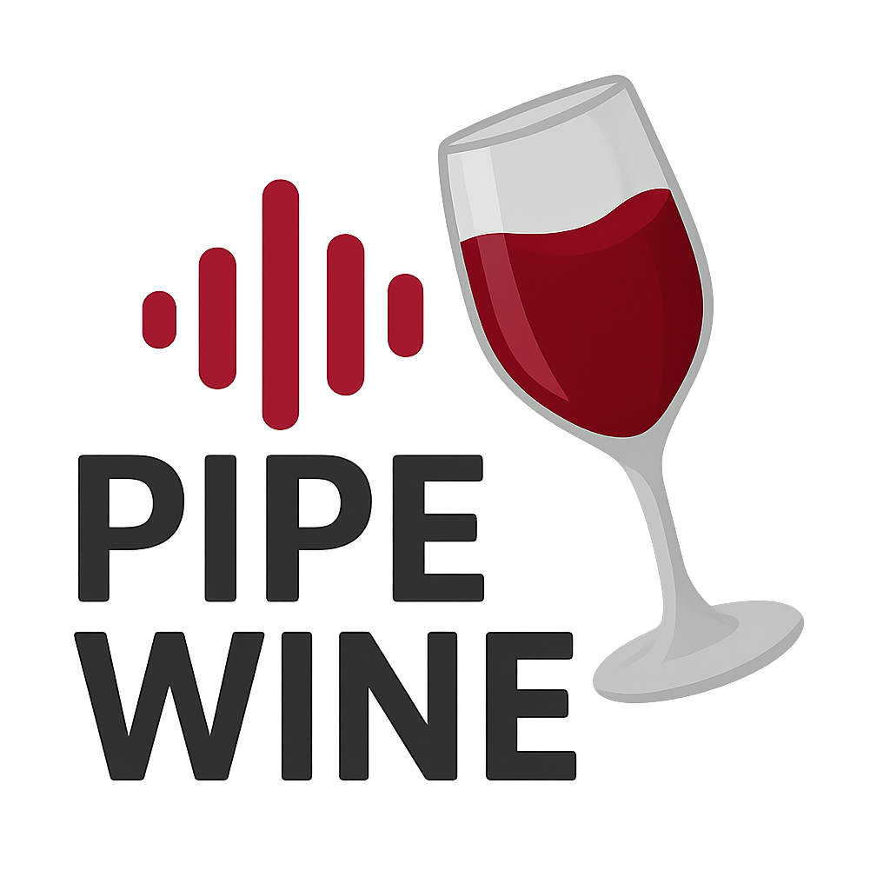

<div align="center">
  
  
  # PipeWine 🎵
  
  **Professional ASIO Driver for PipeWire on Linux**
</div>

PipeWine lets Windows ASIO audio applications running under Wine use PipeWire on Linux. It supports configurable audio channels, device selection, and short MIDI messages through a driver-specific extension. The current installer and regression suite target 64-bit Wine.

[](LICENSE)
[](https://www.winehq.org/)
[](https://pipewire.org/)

## ✨ Features

### 🎯 **Audio Performance**

- **Real-time audio processing** on a Wine-created PipeWire data thread
- **Validated buffer management** with allocation failure cleanup
- **Quantum/rate requests** scoped to the active ASIO node
- **Direct host callbacks** without a second thread handoff each audio cycle

### 🎛️ **Flexible Configuration**

- **GUI control panel** with safe modal lifetime and saved preferences
- **File-based configuration** system (`pipewine.conf`)
- **Configuration changes** saved safely; buffer/rate changes require host reset, channel/device changes require reopening
- **Multiple configuration locations** (user and system-wide)

### 🔧 **Advanced Features**

- **Sample rate selection** (44.1kHz, 48kHz, 96kHz, 192kHz); dispose buffers before changing rate
- **Configurable buffer sizes** (16-8192 samples, powers of 2)
- **Multiple channel configurations** (up to 64 inputs/outputs)
- **Automatic audio connections** to selected/default devices, with hot-plug reconnection
- **Reusable driver instances and buffers**, including stop/restart and repeated COM creation
- **Short MIDI messages** of up to four bytes; MIDI ports require manual routing

## 🚀 Quick Start

### Prerequisites

- Linux system with PipeWire
- Wine 9.0 or later
- A 64-bit system and Wine prefix
- GCC/G++ with C++20 support, Make, pkg-config, Wine development tools, PipeWire headers, and Qt6 development tools

Install the [build dependencies](#build-dependencies) before running the installer.

### Installation

```bash
# Clone the repository
git clone https://github.com/alex190291/pipewine.git
cd pipewine

# Build and install into ~/.wine (run without sudo)
./install.sh
```

The installer copies the 64-bit driver and control panel into the selected Wine
prefix, registers PipeWine, and backs up replaced files under `.pipewine-backups`.
It creates `<prefix>/pipewine-run`, which supplies Wine's driver search path, and
updates existing `launch-ableton.sh` scripts under `drive_c/ProgramData/Ableton` to
use it when they contain an `exec wine` or `exec wine64` command. Restart Ableton
from its updated launcher after installing.

The default prefix follows `WINEPREFIX`, falling back to `~/.wine`. System Wine
and Proton installations are untouched. Other application launchers should use
`<prefix>/pipewine-run` instead of `wine`.

| Option | Purpose |
| --- | --- |
| `--prefix PATH` | Install into another 64-bit Wine prefix |
| `--wine PATH` | Use a specific Wine loader, such as a custom runtime's `wine64` |
| `--no-build` | Install existing artifacts from `build64` |
| `--no-ableton` | Skip edits to existing Ableton launchers |
| `--help` | Show usage |

For example:

```bash
./install.sh --prefix "$HOME/.wine-audio" --wine /path/to/wine64
"$HOME/.wine-audio/pipewine-run" /path/to/application.exe
```

### Basic Usage

```bash
# Test the installation
~/.wine/pipewine-run VBASIOTest64.exe

# Launch your DAW and select "PipeWine" as ASIO driver
~/.wine/pipewine-run ~/.wine/drive_c/path/to/your/daw.exe
```

Use the wrapper in your selected prefix if it differs from `~/.wine`.

## ⚙️ Configuration

### Quick Configuration

Open the control panel through your application's ASIO settings, or create
`~/.config/pipewine/pipewine.conf`. If `XDG_CONFIG_HOME` is set to an absolute path,
the user file is `$XDG_CONFIG_HOME/pipewine/pipewine.conf`. The driver uses
`/etc/pipewine/pipewine.conf` when no user file is available.

Environment overrides take precedence over the config file, which takes
precedence over corresponding settings in `HKCU\Software\Wine\PipeWine` and
built-in defaults. The user and system files are alternatives, not merged.

### Example Configuration

```ini
[audio]
sample_rate = 48000
buffer_size = 512
input_channels = 2
output_channels = 2

[devices]
input_device =
output_device =
auto_connect = true
```

Empty device names select PipeWire's default source and sink. Audio connections
pair active ASIO channels with device ports in port order, up to the smaller
channel count. Choose devices in the control panel or supply their PipeWire
`node.name` values in the file.

The driver requests matching quantum and rate while its ASIO node is active.
The host can request another supported buffer size unless fixed buffer mode is enabled.
Buffer/rate changes require a host reset; channel/device changes require reopening
the driver. Hosts must dispose existing buffers before changing the sample rate.
See [quantum behavior](docs/QUANTUM_SYNC_GUIDE.md) for graph conflicts.

### Environment Overrides

| Variable | Setting |
| --- | --- |
| `PIPEWIREASIO_SAMPLE_RATE` | Sample rate in Hz |
| `PIPEWIREASIO_BUFFER_SIZE` | Preferred buffer size, a power of two from 16 to 8192 |
| `PIPEWIREASIO_INPUT_CHANNELS` / `PIPEWIREASIO_OUTPUT_CHANNELS` | Audio channels, 1–64 per direction |
| `PIPEWIREASIO_INPUT_DEVICE` / `PIPEWIREASIO_OUTPUT_DEVICE` | PipeWire device node names |
| `PIPEWIREASIO_AUTO_CONNECT` | Enable or disable automatic audio connections |
| `PIPEWIREASIO_CLIENT_NAME` | Name shown in the PipeWire graph |
| `PWASIO_BUFFERSIZE_IS_FIXED` | Require the configured buffer size |
| `PWASIO_NUMBER_MIDI_INPUTS` / `PWASIO_NUMBER_MIDI_OUTPUTS` | Enable or disable the single MIDI port per direction, 0 or 1 |

Legacy `PWASIO_NUMBER_INPUTS`, `PWASIO_NUMBER_OUTPUTS`,
`PWASIO_PREFERRED_BUFFERSIZE`, and `PWASIO_CONNECT_TO_HARDWARE` remain supported
and override the corresponding `PIPEWIREASIO_*` values when both are set.

```bash
PIPEWIREASIO_SAMPLE_RATE=48000 PIPEWIREASIO_BUFFER_SIZE=256 \
  "$HOME/.wine/pipewine-run" /path/to/application.exe
```

## ✨ Known Issues and Limits

- **DAW/portal interaction:** You need to disable your DAW's audio engine, otherwise programs started after the DAW can't create PipeWire portals. This reported issue remains unresolved on the affected setup.
- **Graph conflicts:** If PipeWire's rate or quantum differs from the ASIO request, the driver outputs silence until they match.
- **MIDI:** The driver-specific extension handles messages of at most four bytes. Larger payloads, including SysEx, are discarded. Audio auto-connect does not route MIDI ports.
- **Validation scope:** Physical-device latency, long DAW sessions, and 32-bit builds need separate testing.

## 🎵 Audio Applications

### Tested Applications

| Application | Status | Notes |
|-------------|--------|-------|
| VBASIOTest64 | ✅ Working | Basic ASIO functionality confirmed |
| Ableton Live 11 | ✅ Working | Successfully tested with audio playback |

These are previously reported application results. The latest automated checks
use test hosts and virtual PipeWire endpoints; they do not establish compatibility
with every DAW or hardware interface.

### Performance Notes

- Performance benchmarks are not yet available
- Latency depends on buffer size configuration and PipeWire quantum settings
- The driver requests matching quantum/rate; competing graph constraints can temporarily cause silence

## 🛠️ Building from Source

### Build Dependencies

```bash
# Fedora/RHEL
sudo dnf install gcc gcc-c++ make pkgconf-pkg-config wine-devel pipewire-devel qt6-qtbase-devel

# Ubuntu/Debian  
sudo apt install build-essential pkg-config wine wine-dev libpipewire-0.3-dev qt6-base-dev qt6-base-dev-tools

# Arch Linux
sudo pacman -S base-devel wine pipewire qt6-base
```

### Build Commands

```bash
# 64-bit build (recommended)
make 64

# Debug build
DEBUG=true make 64

# Clean build
make clean
```

See [the build guide](docs/BUILD.md) for Qt tool overrides and build troubleshooting.

## 🧪 Validation

```bash
./tests/run_regressions.sh
```

The latest 64-bit validation passed **239 checks** covering COM ownership and
repeated driver creation, allocation rollback, buffer recreation, sparse audio
channels, MIDI/config bounds, GUI lifetime, device routing, hot-plug reconnection,
and stop/restart while a callback is in flight.

The runner builds the driver and tests, uses an offscreen Qt GUI, and creates a
temporary Wine prefix and private PipeWire server under `/tmp`. It retains logs
and artifacts for diagnosis and prints their location. It leaves the normal Wine
prefix and session PipeWire configuration untouched.

See [the driver review](docs/DRIVER_REVIEW.md) for fixes, test coverage, and
additional optimization priorities. CPU and latency improvements have not been
benchmarked on physical hardware.

## 🐛 Troubleshooting

### Common Issues

**Q: Driver not appearing in ASIO applications**

```bash
# Re-register the driver
./install.sh --no-build
```

Use the same `--prefix` and `--wine` options as your original installation.
For a driver installed into a prefix, launch applications through its
`pipewine-run` wrapper so Wine can find the driver and its control panel.

**Q: High latency or audio dropouts**

Try a larger ASIO host buffer and inspect the graph with `pw-top`. The driver
requests the host quantum while active. See [the quantum guide](docs/QUANTUM_SYNC_GUIDE.md).

## 🤝 Contributing

We welcome contributions!

### Development Setup

```bash
git clone https://github.com/alex190291/pipewine.git
cd pipewine
make 64
./tests/run_regressions.sh
```

### Code Style

- Follow Linux kernel coding style
- Use meaningful variable names
- Add comments for complex algorithms
- Test changes thoroughly

## 📄 License

### Copyright Notice

```
Copyright (C) 2006 Robert Reif
Portions copyright (C) 2007 Ralf Beck
Portions copyright (C) 2007 Johnny Petrantoni
Portions copyright (C) 2007 Stephane Letz
Portions copyright (C) 2008 William Steidtmann
Portions copyright (C) 2010 Peter L Jones
Portions copyright (C) 2010 Torben Hohn
Portions copyright (C) 2010 Nedko Arnaudov
Portions copyright (C) 2011 Christian Schoenebeck
Portions copyright (C) 2013 Joakim Hernberg
Portions copyright (C) 2020-2024 Filipe Coelho
Portions copyright (C) 2024-2025 Dawid Kraiński
```

### License Terms

- **Library Code**: The WineASIO library code is licensed under **LGPL v2.1** or later. See [LICENSE](LICENSE) and source headers.
- **GUI Code**: The WineASIO settings UI code is licensed under **GPL v2+** or later.

## 🙏 Acknowledgments

- **WineASIO Project** - Original ASIO implementation for Wine
- **RtAudio Project** - Cross-platform audio I/O library and inspiration
- **Wine Project** - Windows compatibility layer
- **PipeWire Team** - Modern Linux audio infrastructure
- **ASIO SDK** - Steinberg's Audio Stream I/O SDK
- **Linux Audio Community** - Continuous support and feedback

## 📞 Support

- **🐛 Bug Reports**: [GitHub Issues](https://github.com/alex190291/pipewine/issues)
- **📚 Documentation**: [Build guide](docs/BUILD.md), [quantum guide](docs/QUANTUM_SYNC_GUIDE.md), and [driver review](docs/DRIVER_REVIEW.md)
- **📧 Email**: attax@nosinu-records.com

## 🌟 Star History

If PipeWine helps your audio workflow, please consider giving it a star! ⭐

[](https://star-history.com/#alex190291/pipewine&Date)

---

**Made with ❤️ for the Linux audio community**
